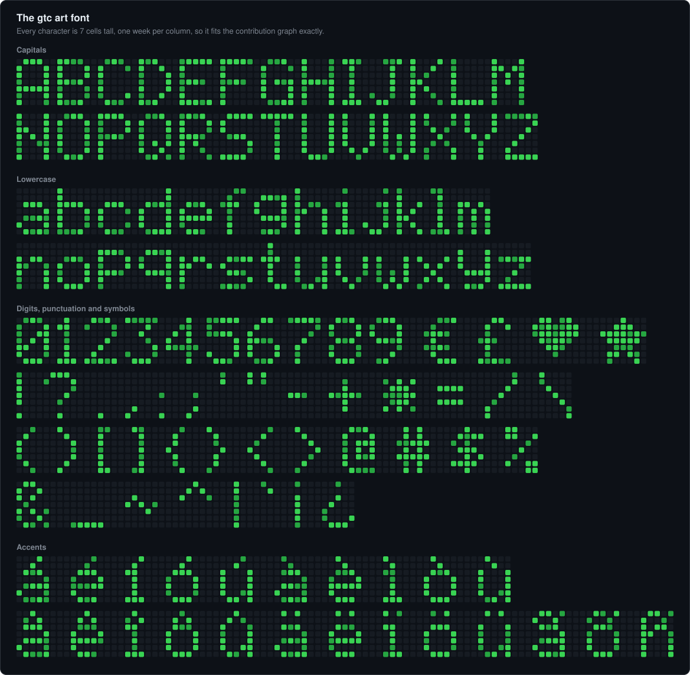
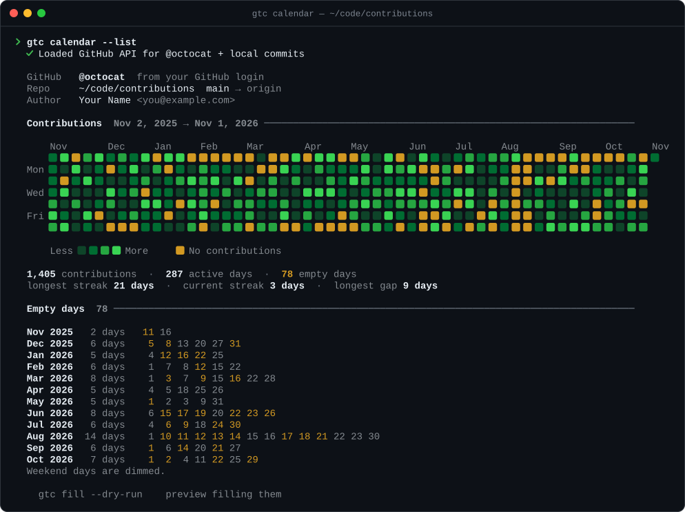
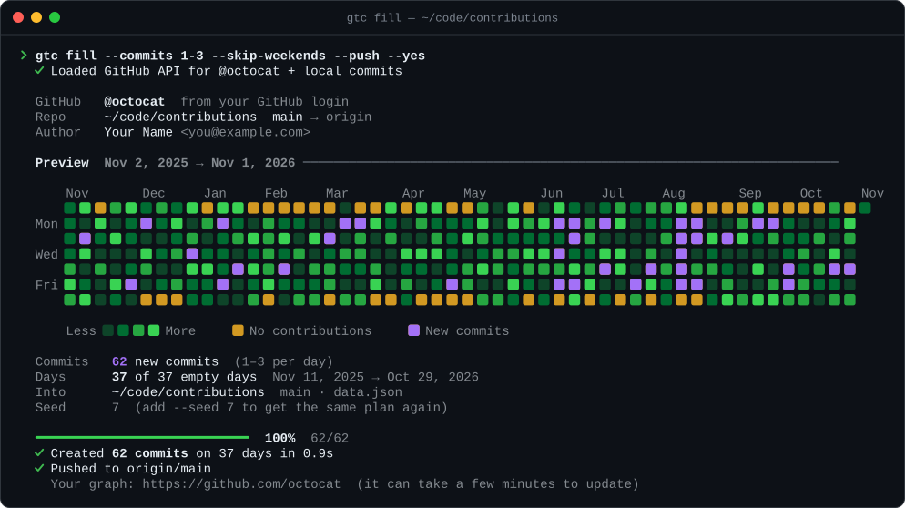

<div align="center">

# GitTimeChanger

**Write words across your GitHub contribution graph, or fill only the days you missed.**

A zero-dependency terminal tool that draws pixel text like **Hello** on your contribution calendar, finds the days with no commits, and previews every change before it creates a single backdated commit.

[](https://www.npmjs.com/package/git-time-changer)
[](https://nodejs.org)
[](package.json)
[](#license)
[](https://github.com/zamansheikh/git-time-changer/stargazers)


```bash
npx git-time-changer@latest art "Hello"
```

</div>

## Contents

- [Features](#features)
- [Quick start](#quick-start)
- [Usage](#usage)
- [How it works](#how-it-works)
- [Make sure the commits count](#make-sure-the-commits-count)
- [Undoing commits](#undoing-commits)
- [Development](#development)
- [Responsible use](#responsible-use)

## Features

- **Text art.** `gtc art "Hello"` writes words on your graph with a built-in 7-cell font: capitals, lowercase, digits, punctuation, accents and symbols like ♥ ★. The text goes in the quietest stretch of your year, with enough commits per cell to show in the darkest green.
- **Empty-day finder.** Reads your contribution calendar from GitHub and from local git history, highlights every day without contributions, and lists them month by month.
- **Fill only the gaps.** Commits land on empty days and nowhere else. Choose how many commits per day, what share of the gaps to fill, and whether to skip weekends.
- **Preview before writing.** Every command first draws the calendar with the new commits in purple. `--dry-run` stops there.
- **Interactive terminal UI.** Arrow-key menus, a live progress bar, and an optional push at the end.
- **Commits land on the right square.** Each commit gets a time between 09:00 and 23:00 when your local date and the UTC date are the same, so time zones can't push it onto a neighbouring square.
- **Leaves your work alone.** Only `data.json` is committed. Anything else you have staged stays staged.
- **Zero dependencies.** Needs only Node.js 18.3+ and git. Run it with `npx` or install it once and use it in any repo.
- **Scriptable.** Every step has a flag. Add `--json` for machine-readable output and `--seed` to repeat a plan exactly.

## Quick start

**1. Pick a repository for the commits.** Any repo you own on GitHub works. A fresh one keeps things tidy, and text reads best on a quiet graph. Don't use a fork: GitHub doesn't count commits made in forks. A private repo works if your profile shows private contributions.

**2. Run GitTimeChanger inside it:**

```bash
cd path/to/your-repo
npx git-time-changer@latest art "Hello" --dry-run
```

`--dry-run` previews the text on your graph without committing anything. To open the interactive mode instead, run `npx git-time-changer@latest` on its own. It finds your GitHub username, draws your graph and lets you choose what to do: draw text, fill empty days, and more.

These commands work the same in every common terminal: zsh and bash on macOS and Linux, fish, PowerShell and Windows Command Prompt.

### Install

| How | Command | Then run |
| --- | --- | --- |
| No install | `npx git-time-changer@latest` | — |
| Global install | `npm install -g git-time-changer@latest` | `gtc` in any repo |
| From source | `git clone https://github.com/zamansheikh/git-time-changer.git`, then `npm link` inside the new folder | `gtc` in any repo |

`@latest` makes `npx` fetch the newest version even if an older one is installed. Run the global install command again to update `gtc`. Every command takes `--repo <path>` if you'd rather not `cd` into the target repo.

## Usage

### Draw text on your graph

```bash
gtc art "Hello" --dry-run
gtc art "Hello" --push
```

The first command previews where the text goes. The second draws it and pushes.

**Text with `!` or `$`?** Wrap it in single quotes: `gtc art 'Hi!'` works in zsh, bash, fish and PowerShell. Inside double quotes, zsh and bash treat `!` as a history command, so instead of running, the terminal waits at a `>` or `dquote>` prompt (press Ctrl+C to get out). In Windows Command Prompt, use double quotes: `gtc art "Hi!"`.

The graph is 7 cells tall (Sunday to Saturday) and about 52 weeks wide, so short words work best: around 8 to 10 characters fit in a year. GitTimeChanger:

- **places the text** in the stretch of full weeks with the fewest existing contributions, so other activity doesn't blur the letters. Use `--start <date>` to pick the spot yourself, or `--year 2025` to draw on another year's graph;
- **sets the brightness** by adding just enough commits to each lit cell to reach the darkest green, based on how busy your graph already is. Use `-n 3` for a fixed number per cell instead;
- **warns you** when days around the letters already have contributions, so the text won't look perfectly clean.

Every character in the font:



Lowercase letters have ascenders, and characters like é, ñ and ü keep their accents. Capitals with accents are drawn without them (É becomes E) because a capital already uses all 7 rows. Curly quotes, dashes, ß and similar characters are swapped for close equivalents.

### Interactive mode

```bash
gtc
```



### See your empty days

```bash
gtc calendar --list
```



Amber squares are days without contributions. `--list` prints them all, grouped by month, with weekends dimmed. Add `--json` to get the same data for scripts.

### Fill only those days

```bash
gtc fill --commits 1-3 --skip-weekends --dry-run
gtc fill --commits 1-3 --skip-weekends --push
```

Preview first, then run it again with `--push` to create the commits and push them.



### Commands

| Command | What it does |
| --- | --- |
| `gtc` | Interactive mode: graph, menu, preview, commit, push. |
| `gtc art <text>` | Write text across the graph. Aliases: `draw`, `text`. |
| `gtc calendar` | Show the graph, stats and empty days. Aliases: `cal`, `show`, `gaps`. |
| `gtc fill` | Commit only on days with no contributions. |
| `gtc random` | Spread a total number of commits over random days in the range. |
| `gtc date <day…>` | Commit on specific days: `2026-10-30`, `2026-10-01..2026-10-07`, `today`, `yesterday`. |

### Options

| Option | Default | Description |
| --- | --- | --- |
| `-u, --user <login>` | auto-detected | GitHub user whose graph to read. |
| `-r, --repo <path>` | current folder | Repository to commit into. |
| `--source <name>` | `auto` | Where to read contributions: `auto`, `github` or `local`. |
| `--year <yyyy>` | | Use a whole calendar year. |
| `--from <date>` / `--to <date>` | last 12 months | Custom range, `YYYY-MM-DD`. |
| `-n, --commits <n\|a-b>` | `1-4` / `300` / auto | Commits per day for `fill` and `date`; total for `random`; per lit cell for `art`. |
| `--start <date>` | quietest spot | `art`: the week the text starts in. |
| `--density <percent>` | `100` | Share of empty days to fill. Lower values leave a few natural-looking gaps. |
| `--skip-weekends` | off | Leave Saturdays and Sundays alone. |
| `--only-empty` | off | `random`: use empty days only. |
| `--seed <value>` | random | Repeat the exact same plan. |
| `--file <path>` | `data.json` | The file each commit changes. |
| `--dry-run` | off | Show the plan without committing. |
| `--push` | off | Push when done. Interactive mode asks instead. |
| `-y, --yes` | off | Skip the confirmation prompt. Required when there's no terminal to ask. |
| `--list` | off | `calendar`: list every empty day. |
| `--json` | off | `calendar`: print JSON. |
| `--no-color` | off | Plain output. `NO_COLOR` is respected too. |

### Recipes

Write on last year's graph, with exactly 5 commits per lit cell:

```bash
gtc art "I ♥ code" --year 2025 -n 5
```

Pick where the text starts:

```bash
gtc art "Hi" --start 2026-03-01 --dry-run
```

Fill every gap in 2025 with 2–5 commits each, then push:

```bash
gtc fill --year 2025 --commits 2-5 --push
```

Fill about 80% of the gaps on weekdays only, so the graph keeps a few empty days:

```bash
gtc fill --density 80 --skip-weekends
```

The old indexRan.js behaviour, 300 commits on random days of the last year:

```bash
gtc random -n 300
```

A few commits on specific days:

```bash
gtc date 2026-10-28 2026-10-30..2026-10-31 -n 3
```

Empty days as JSON, for your own scripts (needs [jq](https://jqlang.org)):

```bash
gtc calendar --user octocat --json | jq .emptyDays
```

## How it works

1. **Read the graph.** GitTimeChanger uses the first of these that works:
   - the GitHub GraphQL API, if a token is available (`GITHUB_TOKEN`, `GH_TOKEN`, or a logged-in [`gh`](https://cli.github.com) CLI);
   - the public contributions page that github.com renders for your profile (no token needed).

   It also counts the commits in the target repository authored with your git email. A day is **empty** only when every source reports zero.
2. **Plan.** It picks the empty days, as many as `--density` asks for, minus weekends if you skip them, and a commit count for each. Nothing is written yet; you see the plan on the calendar.
3. **Commit.** For each commit it rewrites `data.json` with `{ "date", "author" }` and commits only that file, with `GIT_AUTHOR_DATE` and `GIT_COMMITTER_DATE` set to the planned time.
   For `art`, the plan is the lit cells of your text, laid out one week per column starting on a Sunday.
4. **Pick safe times.** Times are random between 09:00 and 23:00 local time, limited to hours where the UTC date equals the local date. Days are never in the future, and today's commits are never later than now.

## Make sure the commits count

GitHub only shows a commit on your graph when all of these are true ([GitHub docs](https://docs.github.com/en/account-and-profile/setting-up-and-managing-your-github-profile/managing-contribution-settings-on-your-profile/why-are-my-contributions-not-showing-up-on-my-profile)):

- The commit email (`git config user.email`) is **added and verified** on your GitHub account.
- The commits are on the repository's **default branch**. GitTimeChanger warns you if you're on another branch.
- The repository is **not a fork**.
- For a **private** repository, *Include private contributions on my profile* is turned on.

After pushing, the graph can take a few minutes to update.

## Undoing commits

Each run tells you how many commits it created. To remove them:

Not pushed yet: drop the last N commits and keep any other local changes.

```bash
git reset --keep HEAD~N
```

Already pushed: reset, then force-push. This rewrites history on GitHub.

```bash
git reset --keep HEAD~N
git push --force-with-lease
```

Deleting the repository on GitHub also removes its commits from your graph.

## Development

- `npm test` runs the unit tests (node:test, no dependencies).
- `npm run showcase` regenerates the screenshots in `docs/images/`.
- `node bin/gtc.js --help` runs the CLI from source.

```text
bin/gtc.js                  executable (npm bin: gtc, git-time-changer)
src/
├── cli/                    the app: arguments, commands, interactive mode
│   ├── index.js            parses arguments and dispatches
│   ├── commands/           one file per command: calendar, fill, random, date, art
│   ├── interactive.js      menu-driven mode (gtc with no command)
│   ├── context.js          range, repo and GitHub user; loads the graph
│   ├── run.js              confirmation, commits, progress, push
│   ├── output.js           banner, graph, plan summary
│   ├── help.js             --help text
│   └── helpers.js          shared errors and small utilities
├── core/                   pure logic, no I/O
│   ├── dates.js            calendar-day math, ranges, date parsing
│   ├── stats.js            empty days, streaks, levels
│   ├── font.js             the 7-cell font for gtc art
│   └── plan.js             commit plans (fill, random, date, art), safe timestamps
├── services/               talking to the outside world
│   ├── git.js              inspect a repo, read history, commit, push
│   └── github.js           GitHub API and public profile readers
└── ui/                     terminal output
    ├── term.js             colors, layout, spinner, progress bar
    ├── prompt.js           arrow-key select, confirm and text prompts
    └── calendar.js         heatmap, legend, stats, empty-day list
test/                       unit tests, mirroring src/
scripts/showcase/           renders docs/images/*.svg from the real UI code
docs/images/                README screenshots
data.json                   the file each commit rewrites when run in this repo
```

The screenshots aren't hand-drawn: `scripts/showcase` runs the same rendering code the CLI uses on seeded demo data and converts the colored output to SVG.

### Releasing

```bash
npm version minor     # bump the version and tag it
npm publish           # runs the tests first (prepublishOnly)
git push --follow-tags
```

## Responsible use

A contribution graph is a picture of activity, not proof of work. Good uses for this tool: backfilling work you really did somewhere GitHub can't see, drawing on your graph for fun, or learning how git dates work. Please don't use it to mislead employers, clients or anyone else.

## Author

**Zaman Sheikh**

<p>
<a href="https://twitter.com/zamansheikh_cse" target="blank"></a>
<a href="https://linkedin.com/in/zaman360live" target="blank"></a>
<a href="https://fb.com/zamansheikh.404" target="blank"></a>
<a href="https://www.codechef.com/users/zamansheikh" target="blank"></a>
<a href="https://www.hackerrank.com/zamansheikh" target="blank"></a>
<a href="https://codeforces.com/profile/zaman360live" target="blank"></a>
<a href="https://www.leetcode.com/zamansheikh" target="blank"></a>
<a href="https://auth.geeksforgeeks.org/user/zamansheikh" target="blank"></a>
<a href="https://www.topcoder.com/members/zamansheikh" target="blank"></a>
</p>

If this saved you some time, you can [buy me a coffee](https://www.buymeacoffee.com/zamansheikh).

<a href="https://www.buymeacoffee.com/zamansheikh"></a>

## License

Released under the [ISC License](LICENSE).
